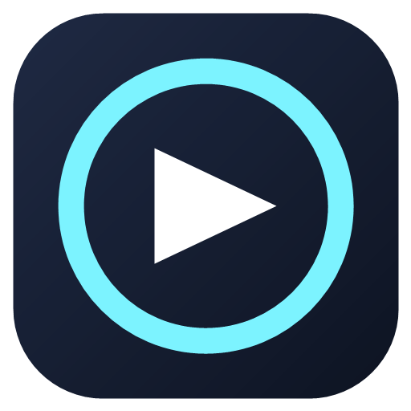

<p align="center">
  
</p>

<h1 align="center">GameFocus</h1>

<p align="center">
  A Windows desktop app that collects your games from many launchers in one library,
  tracks how long you play, and helps you set goals and reflect on your gaming habits.
</p>

<p align="center">
  
  
  
</p>

---

## Features

- **One library for many launchers.** Import games from Steam, Epic Games, Riot Games (League of Legends, VALORANT), Xbox / Microsoft Store, GOG Galaxy, Ubisoft Connect, EA (legacy), Rockstar Games Launcher and Hytale.
- **Add any game manually.** Pick the game's `.exe`, correct its name, and edit it later. Duplicates are detected by executable path.
- **Play time tracking.** Sessions are recorded automatically while a game runs. Total play time is kept per game.
- **Goals.** Create play-time goals for a game. Progress is recalculated from the saved play time, so a new goal starts from the time you already played.
- **Focus game.** Choose a main game for the dashboard.
- **Dashboard and coach.** Weekly hours, recent sessions and simple insights based on your sessions.
- **Dark theme** built with WinUI 3 (Windows App SDK).

## Requirements

- Windows 10 (19041) or Windows 11
- [.NET 10 SDK](https://dotnet.microsoft.com/download) to build from source
- Optional: [Inno Setup](https://jrsoftware.org/isinfo.php) to build the installer

## Build and run

```bash
git clone https://github.com/DITONGO21/focojogos.git
cd focojogos
dotnet build GameFocus.sln
dotnet test GameFocus.Tests
```

Then run `GameFocus.UI` from Visual Studio, or start the built `GameFocus.UI.exe`.

Data is stored in `%LOCALAPPDATA%\GameFocus` (SQLite database, settings and logs). Nothing is sent over the network.

## How game detection works

GameFocus does **not** scan your disks. It only reads the places where each launcher records its installs:

| Source | Where GameFocus looks |
|---|---|
| Steam | `libraryfolders.vdf` and `appmanifest_*.acf` files in your Steam libraries |
| Epic Games | `*.item` manifests in `ProgramData\Epic\EpicGamesLauncher\Data\Manifests` |
| Riot Games | `RiotClientInstalls.json` in `ProgramData\Riot Games` |
| Xbox / Microsoft Store | Sub-folders of `XboxGames` that contain a `Content` folder with an executable |
| GOG Galaxy | `GOG.com\Games` registry entries |
| Ubisoft Connect | `Ubisoft\Launcher\Installs` registry entries that include an install folder |
| EA (legacy) | `EA Games` registry entries |
| Rockstar Games Launcher | `Rockstar Games` registry entries (excluding the launcher and Social Club) |
| Hytale | `%APPDATA%\Hytale\install\<channel>\...\Client\HytaleClient.exe` |
| Manual | Any `.exe` you choose |

Each source only returns games it can identify. Games are never duplicated: the same game found twice in one source is stored once.

## Limitations

- **Launching:** Steam games are launched through the Steam protocol. Other games are launched from their executable when GameFocus knows it. Some launchers do not allow starting a game directly; for those, GameFocus records play time when you start the game yourself.
- **Battle.net, itch.io and the EA app** are not detected yet.
- **Ubisoft** games are only found when the launcher records an install folder.
- **Names** for Ubisoft, Rockstar and Xbox entries come from folder or registry key names, so they may differ from the official game title.
- A session starts when the game process is detected, which can be a few seconds after you launch it.

## Project structure

```
GameFocus.Core            Entities and repository interfaces (no dependencies)
GameFocus.Application     Use cases, services and view models (MVVM)
GameFocus.Infrastructure  EF Core/SQLite, game sources (launchers), registry access
GameFocus.Services        Process monitoring and background services
GameFocus.UI              WinUI 3 application and pages
GameFocus.Tests           Unit and integration tests (xUnit)
```

Database changes are made with EF Core migrations in `GameFocus.Infrastructure/Migrations`.

## Contributing

Contributions are welcome. Please:

1. Open an issue first for larger changes.
2. Keep the layering: views do not talk to the database; view models use services and repositories.
3. Add or update tests for behaviour you change, and make sure `dotnet test` passes.

## License

GameFocus is released under the [MIT License](LICENSE).
